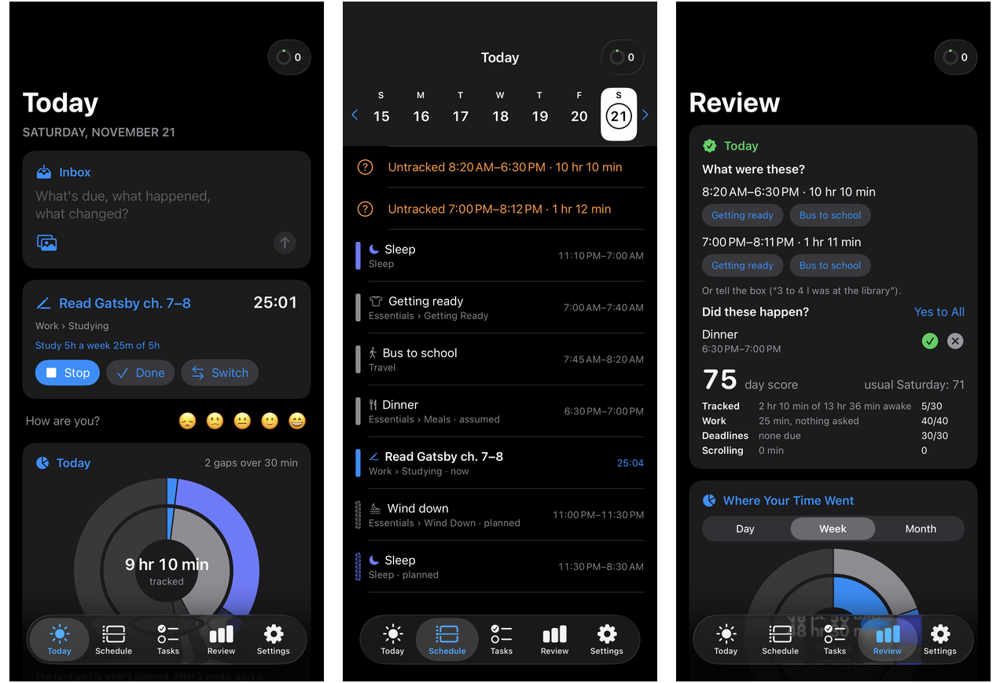

# Productium



an iPhone app that keeps track of your day and plans your homework around it!

you tell it what's going on in plain words, like "chem lab report due thursday, about 2 hours" or "i was at the
library from 3 to 4", and it sorts out the rest. it knows your school timetable, so most of the day fills itself in,
and you only answer the parts it can't guess.

it features:
- one box for everything: tasks, due dates, what you did, how you feel
- buttons to start and stop whatever you're doing, from the app, the lock screen or control center
- a plan that fits homework into the gaps between school, sleep and free time, and moves it when things change
- wake up alarms set from when your first class starts
- a review of each day and week, with a score, your best hours to work and how it compares to usual
- a leaderboard to compare days with friends (only scores and a name are shared)
- sleep and steps from Apple Health, and where you were from location
- screen time from a screenshot, and an optional pause before opening scrolling apps

# Install

on my own iPhone: open **[productium.duckdns.org](https://productium.duckdns.org)** in Safari and tap **Install**. a
Raspberry Pi re-signs the latest release with my Apple ID every few days, so reinstall from there within 7 days to keep
it opening. this only works on phones registered to that Apple ID; everyone else, use one of the ways below.

it's free, but it isn't on the App Store, so you install it with a free Apple ID through
[SideStore](https://sidestore.io):

1. set up SideStore on your iPhone (follow their guide)
2. in SideStore, go to **Sources**, tap **+** and add
   `https://github.com/darshg321/productium/releases/latest/download/source.json`
3. find **Productium** and tap **Get**
4. on the phone, go to Settings → General → VPN & Device Management and trust your Apple ID

SideStore refreshes the app every 7 days so it keeps opening. updates show up in SideStore too.

you can also install it from a computer with [Impactor](https://github.com/claration/Impactor): download
`Productium-free.ipa` from the [latest release](https://github.com/darshg321/productium/releases/latest) and open it in
Impactor with the phone plugged in.

on Linux, one command does all of that. plug in the phone and run:

```sh
curl -fsSL https://raw.githubusercontent.com/darshg321/productium/main/scripts/install.sh | bash
```

it installs what it needs (flatpak, usbmuxd and Impactor), asks for your Apple ID the first time, then downloads the
latest release and puts it on the phone. run it again to update, or within 7 days to keep the app opening. add
`bash -s -- --dev` instead of `bash` at the end to get the latest dev build.

### The AI part

the box uses Claude through a small server of mine that runs on a Raspberry Pi over Tailscale. without it the app
still works: start buttons, the plan, alarms and reviews all run on the phone, and simple things like "start reading"
or "done" work offline. if you have your own server, put its address and key in Settings → Claude.

# Building

there's no Mac involved. the planning code is a Swift package that builds and tests on Linux, and GitHub Actions builds
the app:

```sh
cd Packages/ProductiumCore && swift test
```

every push to `main` makes a new release with the `.ipa`. pushes to `dev` make a separate **Productium Dev** app that
installs next to the normal one with its own data, for testing. more detail is in [DESIGN.md](DESIGN.md).

### Contact
email me at darshg321 (@) gmail.com :)
